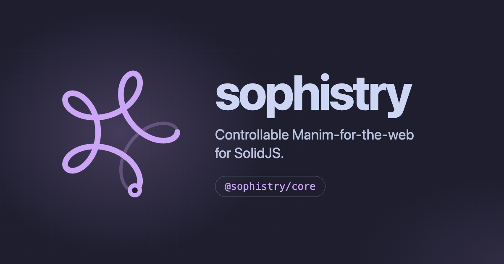

<div align="center">



# sophistry

**Controllable Manim for the web.** Animated maths, charts and explorables,
painted on Canvas2D, with bindings for SolidJS and React.

[Documentation](https://sophistry.dev) ·
[Gallery](https://sophistry.dev/gallery/) ·
[API reference](https://sophistry.dev/api/modules/) ·
[Roadmap](ROADMAP.md) ·
[Contributing](CONTRIBUTING.md)

</div>

> **Pre-1.0.** The packages are `0.x`: minor releases may break. The SolidJS
> binding targets `solid-js` and `@solidjs/web` `2.0.0-rc.14`. See the
> [stability policy](https://sophistry.dev/project/stability/).

sophistry brings the ideas of [Manim](https://www.manim.community/) to the
browser, with one difference: nothing is rendered to a file. Scenes are live,
declarative views. A framework-free core owns the scene graph and a hand-rolled
Canvas2D renderer; thin bindings mount it in your framework, and animations are
seekable descriptions you can
play, pause, scrub, or drive from a slider, a scroll position, or your own code.

## Features

- **Scenes you can lay out.** Shapes expose reactive bounds; place things
  relative to each other (`nextTo`, `alignTo`, `arrange`) like Manim.
- **Seekable animation.** `draw`, `fadeIn`, `moveTo`, morphs, and composites
  (`sequence`, `parallel`, `lagged`, `repeat`). `timeline(anim).seek(t)` scrubs a
  whole script, backwards too.
- **Graphing.** Axes, number planes, polar and complex planes, log scales,
  function, polar and implicit plots, Riemann sums, vector fields, network
  graphs.
- **Charts.** Bar, line, scatter, histogram, box, violin, radar, pie, heatmap,
  contour and more, from `data` plus channel props, in a `<Chart>` frame that
  fits its axes, legend and tooltips to the data.
- **LaTeX as geometry.** `<MathTex>` and `<MathTransform>` turn KaTeX into
  glyph outlines you can draw, morph and animate.
- **3D.** Primitives, surfaces and orbit controls, depth-sorted across solids
  and projected into the same 2D pipeline.
- **Interaction.** Draggable handles, constraints, hit testing, keyboard
  access.
- **Themable.** Catppuccin light and dark themes that follow the page.
- **Tree-shakeable.** Small packages with typed ES modules and `sideEffects: false`.

## Install

Install the core and one binding:

```sh
# SolidJS (pin the release-candidate versions: a plain range resolves to Solid 1)
pnpm add @sophistry/core @sophistry/solidjs solid-js@2.0.0-rc.14 @solidjs/web@2.0.0-rc.14

# React
pnpm add @sophistry/core @sophistry/react react
```

Add `@sophistry/charts`, `@sophistry/text` (LaTeX) or `@sophistry/3d` for the
heavier parts. The [installation guide](https://sophistry.dev/start/installation/)
has the full setup.

## Example

```tsx
import { draw, track } from "@sophistry/core";
import { Circle, Stage, usePlayer } from "@sophistry/solidjs";
import { onSettled } from "solid-js";

function Drawing() {
  const { play } = usePlayer(); // clock and abort-on-dispose are bound for you
  const drawn = track(0);

  onSettled(() => {
    void play(draw(drawn, { duration: 1.5 }));
  });

  return <Circle radius={2} progress={drawn} />;
}

export const Scene = () => (
  <Stage units={8}>
    <Drawing />
  </Stage>
);
```

`track` makes a reactive value, `draw` animates it from 0 to 1 (presets take
`{ duration, delay, easing }`), and `<Stage>` paints whatever the tracks say.
More in the [first scene tutorial](https://sophistry.dev/start/first-scene/).

Stages paint in the browser, and work with server rendering and in Astro
islands; see [embedding](https://sophistry.dev/recipes/embedding/).

## Packages

| Package | What it is |
| --- | --- |
| [`@sophistry/core`](packages/core) | Scenes, tweens, geometry, themes, Canvas2D renderer |
| [`@sophistry/solidjs`](packages/solidjs) | SolidJS components and hooks |
| [`@sophistry/react`](packages/react) | React components and hooks |
| [`@sophistry/charts`](packages/charts) | Charts and data marks |
| [`@sophistry/text`](packages/text) | LaTeX and font outlines as geometry |
| [`@sophistry/3d`](packages/3d) | 3D scenes projected onto the 2D canvas |

## Status

Pre-1.0 and on the Solid 2.0 release candidate. In `0.x`, a minor version may
contain breaking changes and a patch version is fixes only; `/internal` has no
stability guarantee. Details: [stability](https://sophistry.dev/project/stability/),
[roadmap](ROADMAP.md), [changelog](https://sophistry.dev/project/changelog/).

## Contributing

Issues and pull requests are welcome. [CONTRIBUTING.md](CONTRIBUTING.md) covers
the repository layout, commands and conventions; see also the
[Code of Conduct](CODE_OF_CONDUCT.md). Report security issues as
described in [SECURITY.md](SECURITY.md).

## License

[MIT](LICENSE) © 2026 Benjamin Lucier
